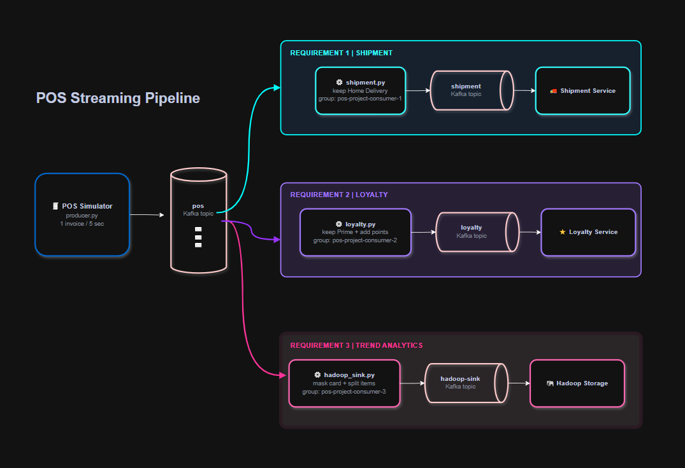
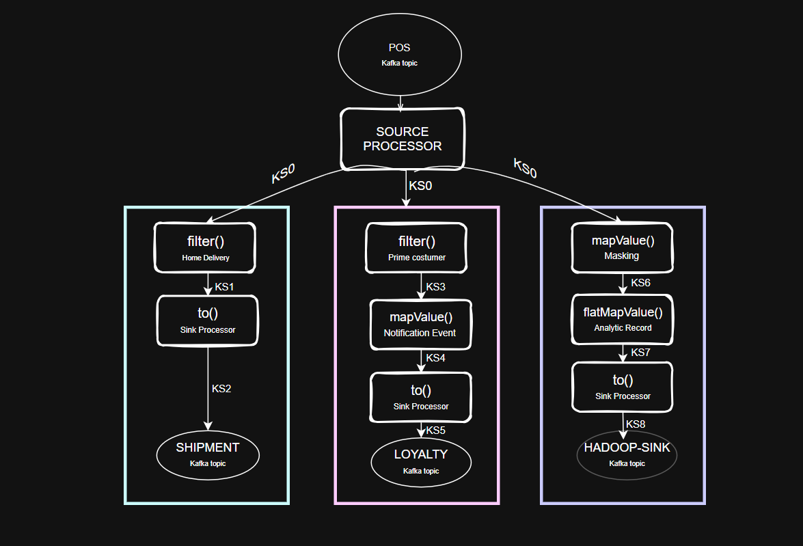

# POS Streaming Pipeline (Kafka + Quix Streams)

A real-time retail data pipeline that simulates POS (Point of Sale) invoices and processes them through Kafka. The pipeline routes incoming invoice data to different services for shipping, loyalty points, and analytics.

## Overview

This project simulates a multi-store retail business where POS systems continuously generate invoices. Using Kafka as the central message broker, invoice data is distributed to independent stream processors, each responsible for a specific business requirement.

The pipeline consists of three processing applications: shipment filtering, loyalty point calculation, and analytics data preparation. Each application consumes invoice data, processes it according to its requirements, and publishes the results to a dedicated Kafka topic.

## Architecture



The pipeline consists of:

- **Invoice Producer:** Generates simulated invoice data and publishes it to the `pos` Kafka topic.
- **Shipment Filter:** Filters home-delivery invoices and forwards them to the `shipment` topic.
- **Loyalty Point Processor:** Identifies eligible customers, calculates loyalty points, and publishes reward events to the `loyalty` topic.
- **Hadoop Sink:** Transforms invoice data, masks customer card numbers, and sends analytics records to the `hadoop-sink` topic for storage and further analysis.

Each processor operates independently using its own consumer group, allowing all three applications to receive and process the same incoming invoice stream.

## Topology
with extra future expantion



The topology illustrates how invoice data flows through intermediate streams, where each processor filters or transforms incoming invoices before publishing them to its designated Kafka topic.

- **Shipment:** Filters invoices based on delivery type.
- **Loyalty:** Filters eligible customers and transforms invoices into reward notifications.
- **Analytics:** Masks customer information and expands invoices into individual item records for further analysis.

## Project Structure

```text
project/
├── docs/
│   ├── architecture.png
│   └── topology.png
├── scripts/
│   └── start-kafka.sh
├── src/
│   ├── Hadoopsink.py
│   ├── invoice_producer.py
│   ├── Loyalty_point.py
│   └── Shipment_filter.py
├── README.md
└── requirements.txt
```

## Setup & Running

### 1. Start Kafka

First, generate a Kafka Cluster ID and initialize the Kafka storage using it.

Make sure your Kafka configuration, broker ID, and Kafka paths are aligned with the broker and Kafka installation you are working with.

Then start Kafka using the startup script:

```bash
bash scripts/start-kafka.sh
```

### 2. Install Dependencies

Install the required Python packages:

```bash
pip install -r requirements.txt
```

### 3. Generate Invoice Data

Run the invoice producer to generate simulated POS invoices and publish them to Kafka:

```bash
python src/invoice_producer.py
```

### 4. Run the Processing Services

Run each processing application in a separate terminal:

```bash
python src/Shipment_filter.py
python src/Loyalty_point.py
python src/Hadoopsink.py
```

## Requirements

- Python 3.9+
- Apache Kafka
- Kafka brokers configured to match your environment
- Required Python packages listed in `requirements.txt`

## Future Expansion

- **Data Security:** Mask sensitive customer information across all output topics.
- **Stream Processing:** Implement windowed aggregations for real-time sales trends and product analysis.
- **Loyalty System:** Introduce different reward rates and stateful customer point balances.
- **Storage:** Connect Kafka to HDFS using Kafka Connect for automated data storage.
- **Analytics:** Use Spark or Hive to analyze stored invoice data.
- **Scalability:** Increase topic partitions and run multiple processor instances.
- **Deployment:** Containerize the pipeline using Docker and Docker Compose.
- **Monitoring:** Track Kafka performance and consumer lag using Prometheus and Grafana.